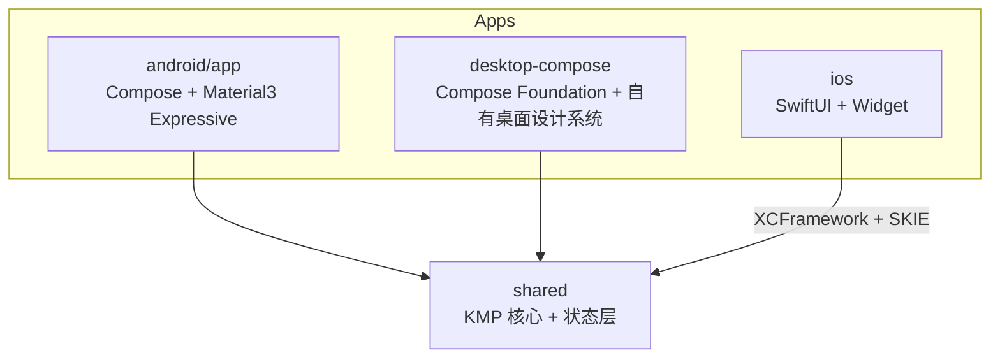

# LoveACE 多端收敛方案：KMP 共享核心 + Compose Multiplatform 桌面端

> 读者：后续负责执行和验证的工程师或 AI 模型。
> 维护者情况：基本一人维护，熟悉 Kotlin。
> 已确认的方向：
> - 共享核心用 Kotlin Multiplatform（KMP）。
> - iOS 保留 SwiftUI。
> - 桌面端从 Flutter 换成 Compose Multiplatform（Compose Desktop）。
> - 不共享 iOS UI。

---

## 1. 为什么要做

### 1.1 现状（2026-10 统计）

| 层 | Android (Kotlin) | iOS (Swift) | Desktop (Flutter) |
| --- | --- | --- | --- |
| 数据层（登录、Service、Model、解析、存储） | 约 4.8k 行 | 约 6.0k 行 | 约 16.7k 行 |
| 状态层（ViewModel / Provider） | 约 2.4k 行 | 约 1.5k 行 | 约 6.8k 行 |
| UI | 约 13.1k 行（其中横屏 4.7k） | 约 4.9k 行 | 约 18.2k 行 |

三端合计约 8 万行。

### 1.2 根本问题

1. **同一套"登录 + 抓取 + 解析"写了三遍。** 例如 `android/.../data/service/YKTService.kt` 和 `ios/loveaceios/Service/YKTService.swift` 的 URL、正则、表单字段、错误文案几乎逐行一致，Dart 版也是同样的逻辑。
2. **学校接口一改，就要修三遍。** 例如 `e92f45c fix(jwc): support updated other exam response` 同时改了三端；manifest v2 也是三端各做一遍（`65f4bdd`、`7c34745`、`721c56a`）。
3. **底层事件不统一。** 三端的 Analytics 事件名一致，但属性值来自各自的 UI 文案或 tab 下标：Android 用 `navItems` 的 label，iOS 用 `tabName(index)`，桌面端用 `_pageNames[index]`，导致 BI 维度不对齐。`5dcd5af`（把 student_hash 改回 md5 以保持跨端一致）就是这类风险的实例。会话过期、重连这些事件也是三端各自实现。
4. **端内也有重复。** Android 有 15 对竖屏 / 横屏页面，另有约 28 个辅助组件和函数（如 `DetailRow`、`BalanceCard`、`calcLaborScore`）在两边各定义了一次。桌面端有 3000 行级别的单文件，还有两个 HTTP client。
5. **几乎没有测试。** 解析靠正则，三端结果是否一致无人验证，重构也没有保护网。

### 1.3 目标

- 学校相关逻辑、协议、解析、业务规则、Analytics、Manifest **只写一次**。
- 新功能的"数据部分"一次完成，各端只写 UI。
- 用一套跨端共享的协议样本（fixture）来保证行为一致。
- 粗略估算，总代码量从约 8 万行降到 4 万到 4.5 万行（桌面端 UI 独立设计、不复用 Android UI，所以比全共享 UI 的方案多一些）。这只是估算，不作为验收指标。

---

## 2. 目标架构

### 2.1 目录结构

```text
LoveACE/
├── settings.gradle.kts            # 新：Gradle 根移到仓库根
├── build.gradle.kts
├── gradle/libs.versions.toml      # 统一版本目录（从 android/gradle 迁过来）
├── gradlew / gradlew.bat
├── shared/                        # KMP 共享核心（无 UI）
│   └── src/
│       ├── commonMain/            # 协议、解析、模型、会话、领域逻辑
│       ├── commonTest/            # fixture 测试
│       ├── jvmCommonMain/         # Android 与 Desktop 共用的 JVM 实现（加密等）
│       ├── androidMain/
│       ├── desktopMain/           # JVM desktop target
│       └── iosMain/               # CommonCrypto / Security / Keychain 等实现
├── android/app/                   # 原 :app，只保留 Android 特有的东西
├── desktop-compose/               # 新桌面端：自有设计系统，不复用 Android UI（迁移期间与 desktop/ 并存）
├── desktop/                       # 旧 Flutter 桌面端，功能对齐并稳定后删除
├── ios/                           # Xcode 工程，链接 shared 产出的 framework
├── spec/
│   ├── fixtures/<系统>/<接口>/<用例>/  # 脱敏后的原始响应 + 期望的解析结果
│   ├── analytics-events.md        # 事件与属性的唯一定义
│   └── feature-matrix.md          # 功能在各端的覆盖情况（唯一事实来源）
├── analytics-worker/
└── utils/manifest_v2/
```

### 2.2 依赖方向



规则：

- `shared` 不依赖任何 UI 框架，也不依赖 `android.*`（`androidMain` 除外）。
- **三端只共享数据层和状态层，不共享 UI。** 桌面端不复用 Android 的页面和组件，见第 3 节"桌面 UI"一行和阶段 5。
- iOS 的 Widget extension **不链接** `shared`，继续用 `Shared/WidgetModels.swift` + App Group `UserDefaults`。原因是 Widget 内存上限很低，Kotlin/Native 运行时会占掉不小的额度。

### 2.3 共享什么，不共享什么

| 放进 `shared` | 留在各端 |
| --- | --- |
| VPN EC 登录、UAAP/CAS 登录、心跳、自动重连 | 各端 UI |
| 统一 HTTP 客户端、Cookie 存储、会话过期检测 | Android：CameraX/ZXing 扫码、Glance 小组件、BLE 门禁硬件交互、生物识别、通知 |
| 所有校园系统的 Service（JWC、YKT、AAC、劳动俱乐部、竞赛、ISIM、报修、门禁的网络部分、评教、课表、培养方案） | iOS：Widget、Keychain 之外的系统集成、BLE 硬件交互 |
| 所有 Model（kotlinx.serialization） | Desktop：窗口、托盘、文件对话框、安装包 |
| 领域逻辑：学分/绩点计算、周次计算、智能排课算法、评教自动填写规则 | 平台的安装和更新动作（APK 安装、打开下载页） |
| Manifest v2 / 学期 / 公告的拉取与解析、版本比较 | |
| Analytics：事件定义、签名、上报、hash | |
| 存储接口（`SecureStore`、`KeyValueStore`、缓存），由各端实现 | |
| 阶段 4 起：状态层（ViewModel 或 Store，暴露 `StateFlow`） | |

---

## 3. 关键技术决策

> 版本号请在动手前到官方文档核实，本文不锁定具体版本。

| 问题 | 决策 | 理由与注意事项 |
| --- | --- | --- |
| HTTP | Ktor Client。Android 和 Desktop 用 OkHttp 引擎，iOS 用 Darwin 引擎 | Android 现有 OkHttp 行为可以平移。**Darwin 引擎必须禁用 URLSession 自带的 Cookie 存储**，让 Ktor 的 `HttpCookies` 插件独占 Cookie，否则两套 Cookie 会打架。重定向由 Ktor 的 `HttpRedirect` 插件处理，确保每一跳都带上 Cookie。这两点必须写测试验证。 |
| Cookie | 自定义 `CookiesStorage`，行为对齐 `android/.../data/network/CookieJar.kt`（`SmartCookieJar`） | 现在 Android 用三个 client（`client`、`simpleClient`、`noRedirectClient`）并且互相 `copyCookiesFrom`。在 Ktor 里改为**三个 client 共享同一个 `CookiesStorage` 实例**，不再手动复制。 |
| 会话过期检测 | 所有 Service 统一通过 `SchoolHttp.fetchText()` 读响应，在这里做 VPN 登录页嗅探（逻辑来自 `HttpClient.isVpnLoginPage`） | 不要在 Ktor 插件里 peek body，那样会让 body 读取变复杂。 |
| HTML 解析 | 优先用 Ksoup（Jsoup 的 KMP 移植版，API 基本兼容），表格类数据从正则改成 DOM 解析 | Kotlin/Native 的正则引擎和 JVM 不同，大段 HTML 上的回溯型正则（比如 YKT 的 8 列 `<td>` 正则）在 iOS 上可能很慢，边界行为也可能不同。 |
| 正则 | commonMain 只能用 `RegexOption.IGNORE_CASE` 和 `MULTILINE`；需要 `DOT_MATCHES_ALL` 时在 pattern 里写内联 `(?s)` | `DOT_MATCHES_ALL` 不是 common API。 |
| 登录加密（RSA PKCS#1 v1.5 + 3DES/ECB/PKCS7 + Base64） | `expect`/`actual`：`jvmCommonMain` 用 BouncyCastle（照搬现有 Android 实现）；`iosMain` 通过 cinterop 调 `Security`（`SecKeyCreateWithData` + `.rsaEncryptionPKCS1`）和 `CommonCrypto`（`CCCrypt` 3DES） | iOS 端可以直接参考 `ios/loveaceios/Network/AUFEConnection.swift` 里已有的 `rsaEncrypt`/`desEncrypt`。用固定输入（固定 key、固定明文）做跨端对拍；RSA PKCS#1 有随机填充，只能验证"能被对应私钥解密"或做格式检查，3DES 可以直接比对密文。 |
| MD5 / SHA-256 / HMAC | KotlinCrypto（`org.kotlincrypto.hash`、`org.kotlincrypto.macs`）或 `expect`/`actual` | Analytics 签名必须与 `analytics-worker` 校验逻辑保持一致，用固定输入做对拍测试。 |
| 序列化 | kotlinx.serialization（现有） | 保留上游 API 的历史拼写，例如 `coureSequenceNumber`。 |
| 键值存储 | DataStore（已支持 KMP）或 multiplatform-settings，二选一 | |
| 敏感凭据 | `SecureStore` 接口：Android 用 Keystore/EncryptedSharedPreferences；iOS 用 Keychain；Desktop 先用 OS 凭据库，失败时回退到本地加密文件 | Linux 的 Secret Service 不一定存在（见 `fed996a`、`377dceb` 的教训），**回退路径必须有**。 |
| Swift 互操作 | SKIE：把 suspend 转成 async，Flow 转成 AsyncSequence，sealed class 转成 Swift enum | 也可以评估 Kotlin 官方的 Swift export，但要先确认它当时的稳定程度。 |
| iOS 集成方式 | `shared` 产出静态 XCFramework；Xcode 加一个 Run Script 阶段调用 Gradle（`embedAndSignAppleFrameworkForXcode`），或者在 CI 里先产出 XCFramework 再给 Xcode 用 | 一人维护的情况下，选最简单、能在本机跑通的方式即可。 |
| 依赖注入 | 不引入 DI 框架。`shared` 提供一个 `LoveAceSession`，负责持有连接并按需懒创建 Service | 对应现在三端的 `AuthViewModel.initServices()`。 |
| AGP 9 | KMP 库模块使用 `com.android.kotlin.multiplatform.library` 插件 | AGP 9 下旧的 `com.android.library` + KMP 组合可能不再被支持，动手前查官方迁移说明。Kotlin 版本也要和 Compose Multiplatform 插件对齐（现在是 Kotlin 2.0.21，需要升级）。 |
| 桌面 UI | **不用默认的 Material3，也不做"放大版平板应用"。** 基于 `compose.foundation` 自建一套桌面设计系统（颜色、字体、间距、按钮、输入框、表格、侧边栏、分栏、菜单），信息架构以现有 Flutter 桌面端（`desktop/lib/winui/screens/winui_main_shell.dart` 的侧边栏页面结构）为蓝本，不以 Android 为蓝本 | 维护者明确不喜欢 Compose 默认的 M3 观感。Material 只是 Compose 之上的一个组件库，不是必须的。可以参考 JetBrains 的 Jewel（IntelliJ 风格）或社区的 Compose Fluent 组件库（Windows 11 风格）的实现思路，也可以直接引入，但先确认维护状态。 |

---

## 4. 分阶段路线图

总原则：**每个阶段结束时都能正常发版，旧实现在新实现验证前不删除。**

### 阶段 0：地基（不改架构，1 到 2 周）

目标：建立行为基线和保护网，修掉会影响迁移的坏习惯。

1. 新建 `spec/fixtures/` 和脱敏规则：
   - 每个用例一个目录：`request.json`（方法、路径、表单参数，不含凭据）、`response.html` 或 `response.json`、`expected.json`（解析结果）。
   - 脱敏：姓名、学号、身份证、手机号、卡号、宿舍号、金额等全部替换成假数据，**保持格式不变**（位数、分隔符、空白）。可以写一个 `spec/tools/sanitize.py` 统一处理。
   - **绝不提交真实学生数据或 Cookie/TWFID/ticket。**
   - 采集来源：iOS 已有的网络诊断日志（`ios/loveaceios/Network/NetworkLogStore.swift`），或在 Android debug 构建里临时加一个响应落盘开关。
2. 写 `spec/feature-matrix.md`：列出每个功能在三端是否存在、入口在哪里、各端有哪些差异。目前已知：
   - 桌面独有：智能排课、学期成绩列表、背景图与调色板设置、Linux AppImage。
   - 移动端独有：门禁（BLE）、报修、扫码、小组件、iOS 的 Insights 页与网络日志导出。
3. 写 `spec/analytics-events.md`：定义稳定的英文 ID，例如 `screen=home|aac|more|settings|scores|exam|...`、`feature=ykt|electricity|labor_club|...`。同时写出旧值到新 ID 的映射，方便 `analytics-worker` 在 BI 里合并历史数据（旧值是各端的中文 label 或 tab 名）。`platform` 取值保持现有的 `android`、`ios`、`macos`、`windows`、`linux`（Worker 已按这些值聚合）。
4. 修 Android 现有的异常处理：main 源码里有 77 处 `catch (e: Exception)`，会吞掉 `CancellationException`，导致协程无法正常取消。引入 `safeCall { }` 包装（遇到 `CancellationException` 就重新抛出，其他异常转成 `UniResponse.failure`），先在 Android 内部用起来，后面整体迁入 `shared`。

完成标准：每个校园系统至少有 1 个"正常"用例和 1 个"空数据或异常"用例；三份 spec 文档都已评审。

### 阶段 1：把 Android 的数据层改造成 KMP（Android 先用）

已确认的顺序：**先把 Android 重构成 KMP，Android 稳定后再接 iOS 和桌面端。**

核心原则：**"搬代码"和"换行为"分开做。** 每一步只做其中一件事，每一步结束都能在 Android 上正常发版。

现状（便于估计工作量）：
- `data/model` 没有任何平台相关的 import，可以直接搬。
- `data/service` 依赖的平台 API 主要是：`android.util.Log`（数据层共 111 处调用）、Jsoup（7 个文件）、OkHttp 的 `Response` API（约 64 处 `body?.string()`、`.code`、`.request.url` 等）。只有 `DoorCardService` 和 `ISIMService` 直接使用了 OkHttp 的类型。
- `data/network` 依赖 OkHttp、BouncyCastle 和 `android.util.Base64`。
- `analytics` 依赖 `org.json`、OkHttp 和 `javax.crypto`。

步骤：

1. **原地去 Android 化（仍在 `:app` 里）。** 不建新模块，只做替换：
   - `android.util.Log` 换成一个自己的日志接口。
   - `android.util.Base64` 换成 `kotlin.io.encoding.Base64`。
   - `org.json` 换成 kotlinx.serialization。
   - 时间相关改用 kotlinx-datetime。
   - 引入 `safeCall`（见阶段 0）。

   这一步不改变任何行为，只在 Android CI 上验证构建，再做一次真机冒烟测试。
2. **调整 Gradle 结构。** 把 Gradle 根移到仓库根，`android/app` 作为一个模块接进来。用 `git mv` 保留历史。同步更新 `.github/workflows/build-apk.yml` 的路径和 `android/AGENTS.md`。
3. **建 `shared` 模块，从第一天起就开 iOS target。** 开 `androidTarget`、`jvm("desktop")`、`iosArm64`、`iosSimulatorArm64` 四个 target。
   - **必须一开始就带上 iOS target。** 只有一个 Android target 时，`commonMain` 里写 JVM API 也能编译通过，等到接 iOS 时才发现大量代码不能用。
   - CI 里加一个 macOS job，至少跑 `compileKotlinIosSimulatorArm64`。
4. **先搬模型。** 把 `data/model` 整体移到 `shared/commonMain`，Android 改 import。
5. **用接口隔离 HTTP，先不换实现。** 在 `commonMain` 定义 `SchoolHttp` 接口（`get`、`post`、`postRaw`，返回自己的 `HttpResult`：状态码、最终 URL、响应头、正文文本）。`androidMain` 先用**现有的 OkHttp `HttpClient`** 实现它。这样迁移 Service 时，网络行为完全不变。
6. **逐个搬 Service**（顺序见阶段 2）。把 OkHttp 的 `Response` 用法改成 `HttpResult`，Jsoup 换成 Ksoup，`DOT_MATCHES_ALL` 换成内联 `(?s)`。每搬一个，配上它的 fixture 测试。
7. **搬登录。** `AUFEConnection` 迁入 `commonMain`，RSA 和 3DES 用 `expect`/`actual` 实现（`jvmCommonMain` 照搬 BouncyCastle）。
8. **最后才换成 Ktor。** 在 `commonMain` 用 Ktor 实现 `SchoolHttp`，在 Android 上切换过去。这是整个阶段 1 风险最高的一步，所以放在最后单独做：出了问题只可能是 HTTP 层，可以切回 OkHttp 实现。稳定一个版本周期后，删除 OkHttp 实现。

完成标准：
- Android Release 构建通过（本机没有 Android 构建环境，走 GitHub Actions）。
- 在真机上验证：登录、自动重连、会话过期检测、三个 client 共享 Cookie 都正常。
- `shared` 的测试在 JVM 和 iOS 模拟器上都通过：覆盖登录页解析（TwfID、RSA 参数、CSRF、lt、execution）、3DES 对拍和已迁移系统的 fixture。

### 阶段 2：迁入所有 Service、领域逻辑、Manifest 和 Analytics

阶段 1 第 6 步搬 Service 时按这里的顺序进行。**对每个校园系统都按第 5 节的检查清单执行**，一个系统一个 PR。建议顺序（从易到难，风险递增）：

1. YKT（一卡通、电费）
2. 竞赛、AAC（第二课堂）、劳动俱乐部（这几个有各自的 ticket 登录）
3. ISIM、报修、门禁的网络部分
4. JWC 全家：成绩、考试、学期、课表、学生课表、培养方案
5. 评教（规则最多，放最后）
6. 智能排课算法：以桌面端 Dart 实现为准移植（`desktop/lib/providers/smart_course_selection_provider.dart`），**连同** `desktop/test/providers/smart_course_selection_provider_test.dart` 一起移植成 `commonTest`。
7. Manifest v2、学期、公告：参考 `desktop/test/manifest_v2_test.dart` 和 `utils/manifest_v2/tests/`。建议给 manifest v2 写一份 JSON Schema 或示例 fixture，让 Python 发布端和 Kotlin 客户端共用，避免两边格式漂移。
8. Analytics：按 `spec/analytics-events.md` 实现；签名算法与 `analytics-worker` 对拍。

完成标准：Android 不再有自己的 `data/service`、`data/model`、`data/network`，只剩平台实现；`commonTest` 在 JVM 和 iOS 模拟器上都能跑通全部 fixture。

### 阶段 3：iOS 接入 `shared`（只换数据层，页面不动）

已确认的原则：**以 Android 为蓝本**。iOS 的页面已经齐全，SwiftUI 的 View 尽量不改，只把数据来源从 Swift Service 换成 `shared`。

这件事可行的依据：Android 的 75 个模型类型中，有 66 个在 iOS 里同名，字段也基本一致（例如 `ScoreRecord` 两边的字段逐个对应）。

1. 产出 XCFramework，接入 SKIE，Xcode 里能编译通过。主 App 链接 `shared`，Widget 不链接。
2. 先接网络层和登录：让 `AuthViewModel` 改用 `LoveAceSession`。
3. 再按阶段 2 的顺序逐个系统替换。**切换点放在 Swift ViewModel**：ViewModel 改为调用 `shared`，删掉对应的 `Service/*.swift`。
4. 模型：View 直接使用 `shared` 的模型，删掉 Swift 里同名的 struct。需要注意以下差异：
   - `Identifiable`：用 Swift extension 给 Kotlin 类型补上，`id` 的拼法照搬原 Swift struct（例如 `ScoreRecord` 用 `"\(termId)_\(courseCode)_\(sequence)"`）。
   - 数字类型：Kotlin 的 `Int` 在 Swift 里是 `Int32`；可空的基本类型（`Int?`、`Double?`、`Bool?`）会变成 `KotlinInt?` 这类包装类型。Android 的 `Models.kt` 里有 17 处这样的字段，View 中用到的地方要转换一下，或者在 Swift extension 里提供计算属性。
   - `Codable`：Kotlin 类型在 Swift 里没有 `Codable`。`ScheduleStore`、`DoorCardStore` 现在用 `JSONEncoder` 存模型，应改为由 `shared` 用 kotlinx.serialization 序列化成字符串，Swift 只负责存取字符串。存储格式变化后，首次启动要能兼容或丢弃旧缓存。
   - Widget 继续用 `Shared/WidgetModels.swift` 自己的模型，由 App 侧把 `shared` 模型转换后写入 App Group。
5. 两处不能直接替换，需要单独处理：
   - **评教**：iOS 和 Android 的模型设计不同（iOS 有 `TeacherEvaluationTask`、`TeacherEvaluationBatchResult`、`TeacherQuestionnaire` 等，Android 是 `TeacherEvaluationIndex`、`TeacherEvaluationPreparedForm` 等）。迁到 Android 版模型后，`TeacherEvaluationView` 和对应的 ViewModel 需要改写。
   - **学期**：iOS 有独立的 `SemesterModels.swift`（`SemesterData`、`SemesterItem`、`SemesterStatus`），Android 的学期数据在 `RemoteManifestService.kt` 和 `SemesterViewModel.kt` 里。以 Android 为准统一到 `shared` 的 manifest 模块。
6. iOS 的网络诊断日志（`NetworkLogStore`，设置页可导出）目前挂在 Swift 的 `HTTPClient` 上。`shared` 的 HTTP 层要提供请求/响应日志回调（注意脱敏，不能记录密码、Cookie、TWFID），iOS 用它继续写 `NetworkLogStore`，否则这个功能会丢失。
7. CI：`ios-testflight.yml` 需要加 JDK 和 Gradle 缓存。

完成标准：iOS 的 `Service/`、`Network/`、`Models/` 只剩平台相关代码（Keychain、BLE、Widget 桥接）；TestFlight 构建通过；真机完成全功能冒烟测试。

### 阶段 4：共享状态层，合并 Android 横竖屏

1. 把 ViewModel 的业务部分迁入 `shared`。可以用 androidx.lifecycle 的 KMP ViewModel，也可以写不依赖 lifecycle 的 Store 类，对外只暴露 `StateFlow<UiState>` 和意图方法。
   - iOS 用一个 `@Observable` 包装类订阅这些 `StateFlow`。
   - 桌面端 Provider 里的逻辑（6.8k 行）以这一层为目标进行合并。
2. Android 用 `WindowSizeClass` 做自适应布局，把 `ui/screen/landscape/` 合并回对应页面。两边重复定义的约 28 个辅助组件和函数提到 `android/app` 的公共组件里。这一步只为 Android 自己减负，不为桌面端服务。

完成标准：`ui/screen/landscape/` 目录消失；Android 横竖屏在手机、平板、折叠屏上都验证过；Android 和 iOS 的 ViewModel 里不再包含业务逻辑。

### 阶段 5：Compose Desktop 桌面端替换 Flutter

1. **先做设计原型（2 到 3 天），维护者认可后再铺开。** 用"学期成绩"一页做样板：侧边栏 + 可排序表格 + 右侧详情分栏，在 macOS 和 Windows 上各跑一次，让维护者亲自看观感。不认可就调整设计系统，不要带着不满意的观感去铺页面。
2. 新建 `desktop-compose`，只依赖 `shared`。UI 基于 `compose.foundation` 和自建设计系统，**不引入 Material3，也不复用 Android 的页面**。
3. 桌面端的设计原则（区别于平板应用）：
   - **导航**：常驻侧边栏，按功能分组；不用底部导航，也不用大卡片网格做入口。
   - **布局**：列表加详情的分栏（例如成绩列表在左、课程详情在右），分栏宽度可拖动；窗口大小和位置下次启动时恢复。
   - **信息密度**：成绩、考试、一卡通流水、购电记录用表格展示，支持按列排序、筛选和多选；行高紧凑，字号比移动端小一档（正文 13 到 14px 左右）。
   - **鼠标**：有悬停状态和 tooltip；右键菜单提供复制、导出；滚动条可见；表格和详情里的文字可以选中复制（`SelectionContainer`）。
   - **键盘**：常用快捷键，例如刷新（macOS 上 Cmd+R，Windows 上 Ctrl+R）、搜索（Cmd/Ctrl+F）、设置（macOS 上 Cmd+,）。修饰键按平台区分。
   - **窗口外观按平台适配**：macOS 用透明标题栏并保留红绿灯按钮，提供系统菜单栏（Compose 的 `MenuBar`）；Windows 用自定义标题栏，评估 Mica 背景。字体用系统字体（macOS 上的苹方，Windows 上的 Microsoft YaHei UI / Segoe UI Variable）。
   - **对话框**：按钮顺序遵循平台习惯（macOS 主按钮在右，Windows 一般是"确定、取消"）。
4. 按 `spec/feature-matrix.md` 逐项对齐桌面端功能，优先做智能排课、培养方案树、学期成绩、CSV 导出、背景与主题设置。这些本来就是适合大屏、表格和树形结构的功能。
3. 打包和发布：
   - macOS：使用 Compose 的 `nativeDistributions`（dmg），配置签名和公证。**Bundle ID 必须保持 `cn.linota.loveace.desktop`**，保证更新和公证的连续性。
   - Windows：用 jpackage 生成 app-image，再继续用现有 Inno Setup 打包。**`AppId` 必须保持 `{024BDD87-AACF-4ABF-8B96-DF312AAC2027}`**，否则不能原地升级。
   - Linux：用 jpackage app-image 加 appimagetool。复用 `desktop/appimage/build-appimage.sh` 的思路；JVM 版本不再需要捆绑 libsecret，但要保留凭据存储的回退路径。
   - 体积：内置 JRE 会让安装包变大，用 jlink 只打包需要的 JDK 模块，Release 构建开 ProGuard。
   - 启动速度：JVM 冷启动比 Flutter AOT 慢，需要实际测量并告诉维护者。
   - 发布：继续通过 `utils/manifest_v2` 发布，平台值不变。
4. 用户迁移：新版本不读取 Flutter 时期的凭据存储，**首次启动重新登录一次**。这比试图解析旧存储更安全。非敏感设置（固定的功能、背景）可选做迁移。
5. 灰度：先用 manifest 推给少量用户或以 Beta 形式发布；Flutter 版本的最后一个安装包保留可下载，方便回滚。

完成标准：功能矩阵中桌面列全部对齐；三个桌面平台安装、升级、登录、导出都验证过；稳定一个版本周期后删除 `desktop/`。

### 阶段 6：收尾

- 删除所有过渡代码和适配层。
- 更新 `README.md` 的仓库结构说明，以及各端 `AGENTS.md`，并新增 `shared/AGENTS.md`（写清楚构建、测试、fixture 规则）。
- 新增 PR 级 CI：`shared` 的 `jvmTest` 和 `iosSimulatorArm64Test`。

---

## 5. 单个校园系统的迁移检查清单

每迁一个系统，按下面的步骤执行，一个系统一个 PR：

1. **以 Android 为蓝本**：Android 的接口调用、模型和字段命名就是迁移的起点。
2. **对照另外两端补漏**：读 iOS 和 Desktop 的实现，找出 Android 没有处理的边界情况（例如桌面端的多时段课程），补进 `shared`。三端行为不一致时，**以学校接口的真实响应为准**，并在 PR 描述里写清楚取舍。
3. **补 fixture**：并集里的每个分支至少有一个 fixture 用例。
4. **迁入 `shared`**：
   - Jsoup 换 Ksoup，`android.util.Log` 换日志接口，`DOT_MATCHES_ALL` 换内联 `(?s)`。
   - 所有对外的 suspend API 都用 `safeCall` 包装，返回 `UniResponse`，**不向外抛异常**（见第 6 节第 4 条）。
   - URL 常量集中到该系统的 `Config` 对象里，不要散落在各个方法里。
5. **测试**：`jvmTest` 和 `iosSimulatorArm64Test` 都跑通。
6. **切换调用方**：先切 Android，再切 iOS；桌面端在阶段 5 统一切换。
7. **删除旧实现**：删除被替换的 Kotlin / Swift 代码，不保留注释掉的旧代码。
8. **真机冒烟测试**：至少验证一次真实登录后的完整流程。

---

## 6. 踩坑清单

1. **不要一次性大迁移。** 每个阶段、每个系统都要能独立发版。一个人维护，最怕的是半成品分支越拖越久。
2. **不要把 iOS UI 换成 Compose。** 维护者已经确认用户在意原生体验；SwiftUI 和 Liquid Glass 是 iOS 端的优势。
3. **Darwin 引擎和 Cookie。** 见第 3 节。iOS 上出现"登录成功但后续请求像没登录"，十有八九是两套 Cookie 存储在冲突，或者重定向时 Cookie 丢失。
4. **Kotlin 异常传到 Swift 会直接崩溃。** 没有 `@Throws` 标注的 Kotlin 函数如果抛异常，iOS 会直接 crash。规则：`shared` 的公开 API 一律返回 `UniResponse`，内部捕获异常；只允许 `CancellationException` 正常传播，并标注 `@Throws(CancellationException::class)`。
5. **不要吞掉 `CancellationException`。** 现有代码大量使用 `catch (e: Exception)`。迁移时统一改用 `safeCall`。
6. **正则在 JVM 和 Native 上的行为可能不同。** fixture 测试必须在 iOS 模拟器上也跑一遍，不能只跑 JVM。
7. **编码。** 目前没有发现 GBK 页面，代码里都按 UTF-8 处理。Kotlin/Native 支持的字符集很少，如果以后遇到非 UTF-8 页面，需要单独处理字节流。
8. **保留上游 API 的历史拼写**（例如 `coureSequenceNumber`），不要"顺手修正"。
9. **Material3 Expressive。** Android 用的是 androidx material3 的 alpha 版本（Expressive，包括 `CircularWavyProgressIndicator`、`LinearWavyProgressIndicator`）。Compose Multiplatform 的 material3 可能还没有这些 API。由于桌面端不复用 Android UI、也不使用 Material3，这个问题只影响 Android 自身：Android 继续直接依赖 androidx 的 material3，不受 CMP 版本影响。
10. **本机构建环境。** 根据 `android/AGENTS.md`，维护者本机没有可用的 Android 构建环境。但只要 Gradle 工程里配置了 Android target，配置阶段就需要 Android SDK。解决方式二选一：本机装上 JDK 和 Android SDK 命令行工具；或者用一个 Gradle 属性（例如 `-Ploveace.skipAndroid=true`）在本机跳过 Android target，只构建 iOS 和 JVM。iOS 的 Xcode 构建依赖 Gradle 产出 framework，所以本机**至少需要 JDK**。
11. **iOS Widget 不要链接 `shared`**，原因见 2.2。
12. **Analytics 的 hash 和签名必须与 Worker 一致。** 迁移后用固定输入和 Worker 的校验逻辑对拍，不要只看"请求返回 200"。
13. **桌面端标识不能变**（macOS Bundle ID、Windows Inno Setup `AppId`、Linux 的 `APPLICATION_ID` 与 `.desktop` 文件名），否则用户的升级链路会断。参考 `d0ba62c`。
14. **不要引入 DI 框架、不要做过度抽象。** 对一人维护的项目，`LoveAceSession` 加手动构造就够了。
15. **iOS 上解析不能跑在主线程。** Swift 在 `@MainActor` 上调用 Kotlin 的 suspend 函数时，Kotlin 代码在第一次挂起之前都运行在主线程。HTML 解析、正则、JSON 反序列化必须包在 `withContext(Dispatchers.Default)` 里，否则大页面会让界面卡顿。
16. **不要在 SwiftUI 的 `body` 里频繁跨语言调用。** 每次访问 Kotlin 对象的属性都有一点桥接开销，字符串还要转换成 Swift 字符串。列表里需要反复计算的值，在 ViewModel 里算好一次。
17. **注意跨语言的循环引用。** Swift 闭包传给 Kotlin（比如回调、Flow 订阅）时用 `[weak self]`；Kotlin 的 GC 和 Swift 的 ARC 之间的循环引用不会被自动回收。
18. **Kotlin/Native 的 Release 链接很慢**（通常要几分钟）。日常开发用 Debug framework，只在归档时链接 Release，CI 里缓存 Gradle 和 Kotlin/Native 的工具链（`~/.konan`）。

---

## 7. 给执行者的工作守则

- 每次开工前先 `git status`，不要覆盖或回滚维护者未提交的改动。
- 遵守各目录的 `AGENTS.md`；它们和本文冲突时，以更具体的 `AGENTS.md` 为准，并在 PR 里指出冲突。
- 一个 PR 只做一件事：一个阶段步骤，或一个校园系统。PR 描述里写清楚：删了多少行、加了多少行、跑了哪些测试、真机验证了什么、哪些没验证。
- 验证结果要如实报告，不要把"编译通过"说成"功能验证通过"。
- 遇到第 8 节列出的待验证假设，先做一个最小的验证（spike），再在 PR 或文档里记录结论。
- 不要提交任何凭据、真实学生数据、签名文件。

---

## 8. 待验证假设

动手前或在对应阶段开始时验证，验证后把结论写回本文：

1. Ktor Darwin 引擎在这个 VPN（深信服 EasyConnect 网关）下的重定向和 Cookie 行为，与 OkHttp 一致。
2. Ksoup 对教务系统老旧 HTML 的解析结果与 Jsoup / SwiftSoup 一致。
3. Compose Multiplatform 当前的 material3 版本对 Expressive 组件的支持程度。
4. AGP 9 + KMP + Compose Multiplatform + SKIE 的版本组合可以同时工作。
5. Compose Desktop 安装包在三个平台上的体积和冷启动时间是否可以接受（需要给维护者具体数字）。
6. Kotlin/Native 的 framework 让 iOS 安装包增加了多少体积。
7. iOS 上的解析性能：在真机（尽量用较老的机型）上，用最大的几个 fixture（培养方案、成绩、一卡通流水）对比 `shared` 和现有 Swift 实现的解析耗时，以及冷启动时间的变化。

---

## 附录 A：现有关键文件对照

| 职责 | Android | iOS | Desktop |
| --- | --- | --- | --- |
| 登录连接 | `android/app/src/main/java/tech/loveace/appv3/data/network/AUFEConnection.kt` | `ios/loveaceios/Network/AUFEConnection.swift` | `desktop/lib/services/aufe/connector.dart` |
| HTTP 客户端 | `.../data/network/HttpClient.kt`、`CookieJar.kt` | `ios/loveaceios/Network/HTTPClient.swift` | `desktop/lib/services/http_client.dart`、`simple_http_client.dart` |
| 服务组装 | `.../ui/viewmodel/AuthViewModel.kt`（`initServices`） | `ios/loveaceios/ViewModel/AuthViewModel.swift`（`initServices`） | `desktop/lib/providers/auth_provider.dart` |
| 校园系统 Service | `.../data/service/*.kt` | `ios/loveaceios/Service/*.swift` | `desktop/lib/services/{jwc,ykt,aac,labor_club,competition,isim}/` |
| 模型 | `.../data/model/*.kt` | `ios/loveaceios/Models/*.swift` | `desktop/lib/models/**` |
| Analytics | `.../analytics/Analytics.kt` | `ios/loveaceios/Service/Analytics.swift` | `desktop/lib/services/analytics_service.dart` |
| Manifest / OTA | `.../service/RemoteManifestService.kt`、`OtaService.kt` | `ios/loveaceios/Service/AnnouncementService.swift` | `desktop/lib/services/manifest_service.dart`、`desktop_update_service.dart` |
| 现有测试 | `android/app/src/test/.../OtaServiceTest.kt` | 无 | `desktop/test/manifest_v2_test.dart`、`desktop/test/providers/smart_course_selection_provider_test.dart` |
